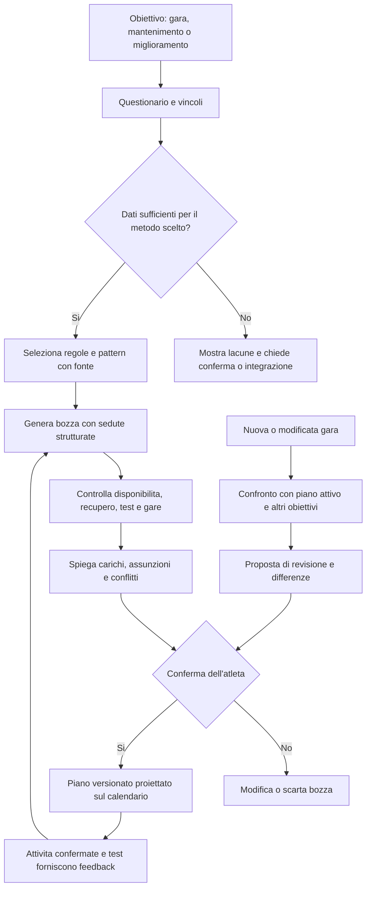

# Paradigma per il motore dei piani di allenamento

## Scopo e perimetro

Questo documento traduce in requisiti progettuali i capitoli di *Tipi che
corrono* pertinenti alla programmazione della corsa. È un'analisi della fonte,
non un piano per un atleta e non una validazione scientifica indipendente dei
protocolli del libro. Le scansioni restano locali in `docs/manuali/`; i numeri
di pagina qui citati sono quelli stampati nel manuale.

Il motore dovrà produrre bozze dettagliate e spiegabili, mai prescrizioni
cliniche. Non deve copiare automaticamente le tabelle del libro nel calendario:
sono esempi riferiti a profili, distanze e condizioni specifiche.

## Evidenze utili alla progettazione

| Tema | Riferimenti | Cosa emerge dalla fonte | Implicazione per il motore |
|---|---|---|---|
| Profili | pp. 13–17; 149–150; 231–232 | Il libro descrive categorie con esperienze, frequenze e motivazioni diverse. Per l'amatore suggerisce di scegliere uno o due obiettivi principali nell'anno; include anche chi corre senza puntare a un primato. | Raccogliere l'autovalutazione e l'intento dell'atleta. Le categorie sono contesto e non soglie per classificare automaticamente una persona. |
| Vocabolario | pp. 16–17 | Le sigle comprendono intensità respiratorie, mezzi di allenamento, ritmi gara e recupero. | Conservare sigle e significati come tassonomia versionata; non trattare un'abbreviazione OCR incerta come istruzione. |
| Vincoli e calendario | pp. 159–162; 241–242 | Gli esempi adattano sedute a tempo disponibile, orari e vita quotidiana; il capitolo evoluto descrive anche doppi allenamenti. | La disponibilità settimanale è un vincolo di input. I doppi e i carichi da evoluto non sono opzioni predefinite per gli altri profili. |
| Valutazione della forma | pp. 163–169; 243–245 | Sono descritti test da campo per ricavare una velocità di riferimento, test specialistici e misure corporee. Il libro raccomanda condizioni comparabili; le cadenze suggerite variano in base al capitolo e al test. | Un riferimento di ritmo deve avere metodo, data e condizioni. Un test scaduto può generare un avviso, non un nuovo ritmo presunto. Test specialistici richiedono un professionista; la composizione corporea non è necessaria per generare il piano. |
| Mezzi di allenamento | pp. 172–192; 249–258 | Lento e lentissimo, variazioni di ritmo, medio/progressivo, lunghi, ripetute, salite, fartlek e lavori specifici per gara hanno obiettivi, intensità e recuperi diversi. I contenuti differiscono fra amatore ed evoluto. | Modellare ogni seduta come blocchi strutturati e collegati a una regola/fonte. Non ricavare durata, ritmo o recupero da una sigla soltanto. |
| Piani-esempio | pp. 194–215; 259–268 | Sono riportati programmi distinti per livello e distanza, di durata diversa; includono giorni di riposo, scarichi, sedute specifiche e, in alcuni esempi, test. | Usarli per identificare pattern e varianti, non come template universali. Ogni pattern utilizzabile deve dichiarare profilo, obiettivo, orizzonte e fonte. |
| Trail e ultra | pp. 180–181; 214–215; 266–268 | Il percorso, il dislivello, il terreno, la gestione corsa/cammino e in alcuni casi la luce/notte cambiano la preparazione; il solo passo al km non descrive adeguatamente lo sforzo. | Per obiettivi trail raccogliere caratteristiche del percorso. Supportare target percettivi/terreno e non forzare un target di passo. |
| Fatica e adattamento | pp. 275–278 | Il libro invita a riconoscere segnali di fatica e a non insistere con lavori impegnativi quando le condizioni non sono buone; il piano personalizzato può essere adattato. | Il feedback di fatica deve poter sospendere una raccomandazione intensa e proporre una revisione, senza diagnosi o modifiche silenziose. |

### Test: interpretazione prudente

Il libro presenta test dei 3 km e 10 km, Conconi e lattato con scopi e
requisiti differenti. I test da sforzo massimo non sono intercambiabili con
un'attività quotidiana di Intervals.icu. Il motore dovrà:

- chiedere quale protocollo è stato realmente eseguito e registrare il
  risultato dichiarato, senza dedurlo da una singola attività;
- associare ritmo di riferimento, fonte, data e condizioni del test;
- segnalare che un riferimento può essere datato, senza aggiornarlo
  automaticamente;
- non proporre test massimali come obbligatori né interpretare test di
  laboratorio o Conconi al posto di un professionista;
- consentire un piano basato su intensità percepita quando non esiste un
  riferimento di ritmo affidabile.

Il testo riporta intervalli di rivalutazione diversi secondo profilo e
protocollo. Non se ne ricava una frequenza universale di test.

### Controllo visivo delle scansioni

Sono state confrontate le immagini originali locali con le pagine stampate
seguenti:

| Pagine stampate | Verifica visiva | Stato per il motore |
|---|---|---|
| pp. 163–169 (parte 2.pdf, scansioni 8–11) | La valutazione della VR, la necessità di condizioni confrontabili, i diversi test da campo e la cautela sull'interpretazione del Conconi sono leggibili. I test indicati per profili diversi non sono intercambiabili. | Le descrizioni possono guidare il modello dei riferimenti di forma. Non automatizzare test massimali, percentuali o risultati dai dati Intervals.icu. |
| pp. 174–179 (parte 2.pdf, scansioni 14–16) | Differenza tra lentissimo/lento, esempi di variazioni (bis/tris), medio/progressivo e lunghissimo sono leggibili; le intensità sono espresse con più indicatori e variano tra profili/obiettivi. | Buona base per la tassonomia e lo schema dei blocchi. Le prescrizioni numeriche vanno selezionate solo da pattern verificati e applicabili. |
| pp. 198–204 | Le tabelle mostrano programmi distinti per 10 km e mezza maratona, con metodo respiratorio o distanza-tempo, giorni di riposo e settimane/test di verifica in punti specifici. | È leggibile che i piani sono specifici e differenziati; non convertire automaticamente tutte le celle OCR in template eseguibili. |
| pp. 204–209 | Le tabelle per maratona/ultra hanno orizzonti diversi e includono sedute specifiche, recuperi ed elementi di scarico; il testo avverte che gli esempi non sono personalizzati. | Gli esempi servono da riferimento editoriale e non da generatore automatico o combinazione di sedute. |
| p. 200 (scansione 27), tabella 6 | Verificati visivamente intestazione e perimetro: esempio di nove settimane per 10 km, metodo distanza-tempo, quattro sedute settimanali. La tabella è distinta dal ciclo respiratorio della tabella 5. | Solo struttura di alto livello registrata; le singole celle non sono ancora trascritte e revisionate come regole. |
| pp. 203–204 (scansioni 28–29), tabella 8 | Verificati visivamente titolo e continuazione: esempio di dodici settimane per la mezza maratona, metodo distanza-tempo e quattro sedute settimanali. | Solo struttura di alto livello registrata; non fondere con la tabella 7 a metodo respiratorio né dedurre i dettagli mancanti. |
| pp. 207–208 (scansioni 31–32), tabella 10 | Verificati visivamente titolo e continuazione: esempio di quindici settimane per la maratona, metodo distanza-tempo e quattro sedute settimanali. | Solo struttura di alto livello registrata; l’esperienza individuale non rende trasferibile la tabella né approva le sue sedute. |
| pp. 212–215 | Gli esempi trail esplicitano allenamento su percorsi simili, dislivello e gestione del terreno; per l'ultratrail sono citati anche cancelli orari e adattamento specifico. | Il modello gara trail deve poter rappresentare dislivello/percorso e target non basati solo sul passo. |

Il controllo è stato limitato a questi passaggi e tabelle pertinenti al primo
modello del motore; non certifica l'intero manuale né la validità scientifica
dei protocolli. Non sono state trascritte le tabelle complete. Per una regola
numerica specifica, la pagina interessata deve essere ricontrollata prima
dell'implementazione.

### Catalogo dei pattern candidati (v0.1)

Le pagine controllate supportano le tipologie sotto elencate, ma non una
prescrizione completa e trasferibile. Il catalogo separa ciò che è osservabile
nella fonte da ciò che l'app potrebbe modellare; nessun elemento qui sotto è
ancora una regola eseguibile.

| ID | Pattern candidato | Evidenza verificata | Rappresentazione ammessa nel catalogo | Non dedurre / stato |
|---|---|---|---|---|
| `easy_effort` | Corsa facile o molto facile | pp. 174–176 (parte 2.pdf, scansioni 14–15): la distinzione tra lento e lentissimo e i riferimenti respiratori sono leggibili. | Intento della seduta e riferimento percettivo dichiarato dalla fonte. | Gli intervalli di durata/distanza sono esempi dipendenti dal contesto; non assegnare passo o volume automatici. Solo catalogato. |
| `rhythm_variation` | Seduta con variazioni di ritmo (B/T) | pp. 175–177 (parte 2.pdf, scansioni 14–15): sono leggibili la struttura generale e alcuni esempi distinti. | Sequenza di blocchi di lavoro e recupero solo quando la variante è stata ricontrollata sulla pagina usata. | B e T non sono intercambiabili; il nome da solo non definisce una prescrizione per l'utente. Non eseguibile. |
| `steady_or_progressive` | Lavoro medio o progressivo | pp. 178–179 (parte 2.pdf, scansione 16): il mezzo e le varianti sono leggibili, con riferimenti dipendenti da VR e obiettivo. | Tipo di stimolo e progressione esplicitamente trascritti dalla fonte selezionata. | Non inventare zone, ritmo, durata o progressione uniforme. Non eseguibile. |
| `long_run` | Lungo/lunghissimo | pp. 174–179 e programmi distinti alle pp. 198–209: il mezzo è presente, con esempi diversi per obiettivo e distanza. | Obiettivo e contesto della seduta, collegati al programma-fonte specifico. | Nessuna durata, distanza o frequenza trasferibile automaticamente. Non eseguibile. |
| `trail_specificity` | Lavoro specifico su terreno e dislivello | pp. 212–215: gli esempi trail fanno riferimento a percorsi simili, dislivello e gestione del terreno. | Requisiti di specificità da confrontare con percorso, terreno e dislivello dichiarati. | Non convertire il dislivello in carico o passo; non generare una seduta senza struttura verificata. Non eseguibile. |
| `recovery_and_cycle` | Riposo, recupero e scarico | pp. 198–209: gli esempi di piano differenziati contengono giorni di riposo e settimane con funzioni diverse. | Annotazione del ruolo di recupero o scarico all'interno dell'esempio cui appartiene. | Nessuna cadenza, percentuale di scarico o regola universale. Non eseguibile. |
| `field_test_reference` | Test di campo e riferimento di forma | pp. 163–169: sono leggibili protocolli distinti e la necessità di condizioni confrontabili. | Protocollo dichiarato, fonte, data e condizioni, separati dal piano di allenamento. | Non rendere i test massimali obbligatori, non equiparare protocolli diversi e non dedurre risultati da attività ordinarie. Non eseguibile. |
| `ten_km_breathing_cycle` | Esempio ciclico 10 km, metodo respiratorio | pp. 197–199 (parte 2.pdf, scansioni 25–26): il testo lo presenta per l'“amatore vero”; nove settimane, quattro sedute settimanali, verifica della VR alla settimana 3 e gara alla settimana 9. La tabella non identifica il protocollo del test. | Riferimento contestuale a una tabella specifica, separato da qualsiasi piano personale. | Non applicare a distanze, profili o disponibilità diverse; non inventare il protocollo di test e non considerare approvata la sequenza delle sedute. Non eseguibile. |
| `ten_km_distance_time_cycle` | Esempio ciclico 10 km, metodo distanza-tempo (tabella 6) | p. 200 (parte 2.pdf, scansione 27): nove settimane e quattro sedute settimanali. | Outline del ciclo con fonte e orizzonte; dettaglio delle sedute da trascrivere. | Esempio fonte, non regola approvata; non intercambiabile con la tabella 5. Non eseguibile. |
| `half_marathon_distance_time_cycle` | Esempio ciclico mezza maratona, metodo distanza-tempo (tabella 8) | pp. 203–204 (parte 2.pdf, scansioni 28–29): dodici settimane e quattro sedute settimanali. | Outline del ciclo con fonte e orizzonte, compresa la continuazione a p. 204. | Esempio fonte, non regola approvata; non fondere con la tabella 7. Non eseguibile. |
| `marathon_distance_time_cycle` | Esempio ciclico maratona, metodo distanza-tempo (tabella 10) | pp. 207–208 (parte 2.pdf, scansioni 31–32): quindici settimane e quattro sedute settimanali. | Outline del ciclo con fonte e orizzonte, compresa la continuazione a p. 208. | Esempio fonte, non regola approvata; l'esperienza personale di adattamento resta un caso di test separato. Non eseguibile. |

#### Perimetro del primo prototipo 10 km (verifica fonte, 5 novembre 2026)

Le scansioni 25–26 sono state ricontrollate per identificare la tabella di nove
settimane del metodo respiratorio. Il perimetro candidato è quindi
deliberatamente ristretto: gara stradale di 10 km, schema della fonte rivolto
all'“amatore vero”, quattro sedute settimanali, test di verifica della VR alla
terza settimana e gara alla nona. Questa evidenza non autorizza a classificare
un atleta come “amatore vero”, né ad applicare il programma a chi ha
disponibilità o preparazione differenti. La tabella non specifica il protocollo
del test in quel punto; non va scelto automaticamente. Il test VR già svolto
è il riferimento di partenza del prototipo, non un test da assegnare o
prescrivere.

Le tabelle 3–4 delle pp. 196–197 sono programmi distinti di sei settimane e
non vanno fuse con lo schema di nove settimane. Anche il programma
distanza-tempo è un'alternativa separata, non inclusa in questo primo perimetro.
Le sedute e i dettagli della progressione non sono ancora trascritti e
verificati cella per cella nel catalogo applicativo: resta quindi un esempio
non eseguibile, non una bozza che l'app possa assegnare.

La sezione «Riscaldamento» inizia a p. 118, come verificato sulla scansione e
confermato dall'atleta; il rinvio a p. 117 nell'introduzione del programma è
da trattare come imprecisione editoriale. Per questo primo perimetro si farà
riferimento alla sezione da p. 118, senza includere la prova dei tre piani di
scale descritta a p. 117. Alla settimana 3 la tabella indica solo una verifica
della VR; i test di campo descritti alle pp. 165–166 hanno protocolli diversi.
Per iniziare si registra un test VR già eseguito e la sua provenienza: l'app
non ordina all'atleta di fare un test massimale. Non si presume che la verifica
della settimana 3 abbia lo stesso protocollo finché non è specificato.

#### Nuovi cicli candidati: tabelle 6, 8 e 10 (struttura verificata)

Il controllo visivo locale delle pagine stampate conferma i tre perimetri:
tabella 6, 10 km in nove settimane; tabella 8, mezza maratona in dodici
settimane; tabella 10, maratona in quindici settimane. Sono tutti esempi a
metodo distanza-tempo con quattro sedute settimanali. La tabella 8 continua
alla pagina successiva e lo stesso vale per la tabella 10; una trascrizione
che si fermi alla prima pagina sarebbe incompleta.

Questa verifica copre intestazioni, orizzonte e frequenza, non certifica ogni
cella, sigla, recupero o criterio di selezione. I tre cicli restano esempi
fonte non eseguibili e non vanno combinati con le corrispondenti tabelle a
metodo respiratorio. Prima di usarli come casi di confronto del generatore
occorre completare una trascrizione strutturata indipendente e una seconda
revisione, mantenendo espliciti i campi assenti. La fonte resta un riferimento
editoriale, non una validazione scientifica del programma.

#### Scenario di variante a tre sedute (esperienza dichiarata, non prescrittiva)

È stato raccolto questo scenario per valutare la flessibilità del motore
rispetto al programma di quattro sedute della tabella 10: svolgerne tre,
saltando di solito una delle sedute meno impegnative; nelle due sedute non
lunghe aggiungere circa 2 km di riscaldamento prima del lavoro previsto e
circa 1 km di defaticamento; aumentare il lungo del fine settimana di circa la
distanza della seduta saltata, in genere quella più breve. Riscaldamento e
defaticamento aggiuntivi non venivano fatti nel lungo. È un adattamento
individuale riferito dall'atleta, non una variante presente nella fonte né
una regola approvata.

Non va applicato automaticamente né presentato come equivalente al ciclo
originale: concentrare sul lungo il volume della seduta omessa cambia la
distribuzione del carico. Prima di poterlo rappresentare come opzione, il
motore dovrà chiedere conferma esplicita, calcolare la distanza in base alla
seduta effettivamente omessa, rispettare disponibilità e limiti dichiarati e
mostrare chiaramente la differenza dall'esempio a quattro sedute. La variante
resta un caso da valutare, non una raccomandazione trasferibile. Il motore non
deve colmare volume mancante con un incremento inventato né modificare il
calendario attivo senza conferma.

#### Riferimento VR strutturato

Per il prototipo vengono registrati protocollo realmente svolto, data,
risultato cronometrico e condizioni del percorso. Per i soli protocolli
documentati e non ambigui il dato al km è derivato così:

- test 3 km + 10%: tempo totale in secondi, aumentato del 10% e diviso per 3;
- test 10 km: tempo totale in secondi diviso per 10.

Il valore resta un riferimento dichiarato dal runner, non una diagnosi o una
validazione automatica delle condizioni del test. Gara/altro protocollo non
vengono convertiti automaticamente. Non è stato stabilito un limite universale
di validità temporale: il generatore deve continuare a segnalare la data e
restare bloccato finché non si approva una regola esplicita di aggiornamento.

#### Dettagli verificati sulle pagine 174–179

La verifica ravvicinata delle scansioni ha confermato questi dettagli, riportati
qui come sintesi degli esempi e non come valori da prescrivere:

- **Lentissimo e lento (pp. 174–175; scansione 14):** il testo distingue le
  due intensità, le collega alla respirazione, allo sforzo percepito e alla VR,
  e fornisce intervalli d'esempio sia in tempo sia in distanza. Include
  indicazioni che dipendono da stanchezza, programma e obiettivo. Gli estremi
  non formano una progressione automatica né una dose adatta a ogni atleta.
- **Bis (pp. 175–176; scansioni 14–15):** è descritto come primo approccio
  alle variazioni, con alternanza di due intensità; sono presenti esempi a
  tempo e a distanza, limiti d'esempio per durata/distanza totale e varianti
  legate a VR, preparazione e obiettivo. Non trasferire al motore un singolo
  esempio senza i relativi presupposti.
- **Tris (pp. 175–177; scansioni 14–15):** introduce tre intensità e cambi
  più frequenti rispetto al bis; gli esempi dipendono dalla VR e dalla
  preparazione. La scansione mostra varianti ulteriori, perciò la sola sigla
  non basta a ricostruire una seduta.
- **Medio e progressivo (pp. 178–179; scansione 16):** il medio è descritto
  in rapporto a capacità, gara e programma; il progressivo cresce
  gradualmente d'intensità e gli esempi usano riferimenti alla VR. Non
  generalizzare le distanze e i ritmi degli esempi.
- **Riscaldamento (p. 174; scansione 14):** è previsto prima di alcuni mezzi e
  il testo lo considera aggiuntivo alla durata/distanza dell'allenamento.
  La sezione dedicata inizia a p. 118; il rinvio p. 117 nell'introduzione
  dello schema 10 km non deve portare a includere la prova dei tre piani di
  scale. Il controllo della scansione 59 (pp. 118–119) conferma una serie
  descrittiva di esercizi di mobilità/preparazione e una breve fase di corsa
  facile prima del lavoro; non stabilisce una durata universale da sommare a
  ogni seduta. Il riferimento è ora registrato nel catalogo come non
  eseguibile; non ricostruire ripetizioni o tempi non previsti dalla regola
  specifica.

La verifica consente quindi una scheda descrittiva con riferimenti e
presupposti; non certifica che i valori siano attuali, sicuri o generalizzabili
né autorizza a usarli per classificare un atleta. La fedeltà dei dettagli
numerici di ogni variante richiede una trascrizione puntuale e una seconda
revisione prima di una regola eseguibile.

#### Prima scheda fonte: bis a tempo (non eseguibile)

**Riferimento:** *Tipi che corrono*, p. 175, scansione 14 di `parte 2.pdf`.
La pagina è leggibile; questa è una sintesi verificata dell'esempio, non una
raccomandazione per l'atleta:

- struttura esemplificativa: cinque tratti di 15 minuti che alternano CRF,
  CRLI, CRF, CRLI e CRF, per 75 minuti complessivi;
- il testo descrive CRF e CRLI usando riferimenti alla VR, sforzo percepito e
  frequenza cardiaca; propone anche varianti a distanza e una collocazione nel
  programma che dipende dall'allenamento complessivo;
- il riscaldamento è trattato separatamente e aggiunto alla durata prevista
  della seduta.

**Cosa può diventare dato di catalogo:** una sequenza a cinque blocchi con
quattro cambi di intensità e i collegamenti alla pagina sorgente. La durata
specifica di 15 minuti è solo quella dell'esempio. Non ci sono in questo
esempio recuperi separati: non aggiungerli al modello.

**Perché non è ancora una regola del generatore:** la pagina non fornisce
criteri sufficienti per stabilire a chi assegnare questa variante, per
verificare la validità e attualità della VR, o per risolvere eventuali
conflitti con gli altri carichi. Senza questi elementi la richiesta deve
restare incompleta; non convertire automaticamente il riferimento VR in
ritmi individuali né sostituirlo con una frequenza cardiaca stimata.

#### Prima scheda di ciclo: 10 km, metodo respiratorio (non eseguibile)

**Riferimento:** *Tipi che corrono*, pp. 197–199, scansioni 25–26 di
`parte 2.pdf`. La descrizione che introduce la tabella indica un programma di
nove settimane per la 10 km, con metodo respiratorio e quattro allenamenti
settimanali, nella sezione dedicata all'“amatore vero” (etichetta dell'autore,
non classificazione dell'app). La tabella mostra riposi o esercizi nei giorni
senza corsa, mezzi di allenamento diversi nel corso delle settimane, un test
di verifica della VR nella terza settimana e la gara nella nona.

Il controllo visivo della scansione 26 conferma che il ciclo è la tabella 5 e
che la tabella prosegue sulle pagine stampate 198–199. Il catalogo registra
soltanto i due punti di controllo espliciti (verifica VR in settimana 3 e gara
in settimana 9) e il rinvio al riscaldamento a p. 118. Non copia le celle
giorno per giorno né trasforma le sigle delle sedute in prescrizioni.

**Cosa può diventare dato di catalogo:** un esempio ciclico con orizzonte,
frequenza settimanale, eventi di test e gara espliciti, tutti collegati alla
fonte. La tabella non specifica in quella cella il protocollo del test: non
assumere che sia quello dei 3 km descritto per un altro programma. La
collocazione in settimana 3 è un elemento di questo esempio, non una cadenza
universale. La revisione visiva non equivale alla verifica e approvazione dei
dettagli di ciascuna seduta.

**Perché non è ancora una regola del generatore:** profilo, distanza,
metodologia e orizzonte sono specifici dell'esempio. La presenza della tabella
non dimostra che i suoi carichi siano appropriati per un atleta attuale o per
un obiettivo diverso. Prima di codificare una singola settimana occorre
verificare ciascuna cella e le definizioni dei mezzi, poi definire criteri di
selezione e di esclusione indipendenti dall'etichetta editoriale.

#### Contratto per una futura regola eseguibile

Prima di usare uno di questi pattern per generare una seduta, la sua scheda
deve includere:

- identificativo e versione stabili, stato della regola (`candidate`,
  `approved_for_drafts` o `retired`), stato di verifica della fonte
  (`unchecked`, `checked` o `ambiguous`) e responsabile dell'approvazione;
- pagina stampata e indice della pagina nella scansione, più sintesi
  controllata visivamente e grado di affidabilità;
- obiettivo, profilo, distanza/terreno e condizioni di applicabilità, con
  esclusioni esplicite;
- struttura completa dei blocchi, unità e recuperi riportati dalla fonte;
  ogni campo assente resta assente, non viene completato per analogia;
- input richiesti, dati mancanti che bloccano la generazione e spiegazione
  mostrata all'atleta;
- test che dimostrino sia la selezione corretta sia il rifiuto della regola
  quando profilo, obiettivo o dati non corrispondono.

La verifica della fonte indica solo che il contenuto è stato ricontrollato
sulla scansione; non significa che sia stato approvato come prescrizione
personalizzata. La promozione ad `approved_for_drafts` richiede anche una
revisione di applicabilità e sicurezza del prodotto. Tutti i pattern restano
`candidate`; il bis a tempo ha una scheda fonte controllata, ma non è una
regola approvata né utilizzabile dal generatore.

Il registro v0.1 è stato portato in
[`training-methodology-rules.js`](../js/modules/training-methodology-rules.js).
Il codice distingue i pattern candidati dagli esempi strutturati della fonte:
il bis a tempo conserva i cinque blocchi e la loro intensità senza aggiungere
recuperi o riscaldamento; lo schema 10 km conserva solo durata, frequenza e
settimane di test/gara, lasciando non specificato il protocollo. Le richieste
di bozza conservano una fotografia dei candidati e degli esempi compatibili
con obiettivo e terreno dichiarati; la scheda Motore piani li mostra insieme
alla fonte e ai limiti del relativo esempio. Questa valutazione è solo
informativa. Il generatore resta disabilitato e nessuna seduta viene creata.

## Paradigma operativo



### 1. Obiettivi e raccolta dati

Il questionario deve distinguere:

- **obiettivo principale**: gara con data e caratteristiche, mantenimento,
  miglioramento generale o altro obiettivo esplicitato dall'atleta;
- **altri eventi**: priorità scelta dall'atleta, data certa o periodo, distanza,
  dislivello e informazioni del percorso disponibili;
- **contesto recente**: frequenza e struttura degli allenamenti, continuità,
  attività già svolte e riferimenti di forma dichiarati;
- **disponibilità**: giorni e durata massima, giorni non disponibili,
  preferenze di terreno e attrezzatura;
- **vincoli dichiarati**: interruzioni, fatica percepita o indicazioni già
  ricevute da professionisti. L'app non diagnostica né interpreta sintomi.

La modalità senza gara è legittima, ma il libro non fornisce un unico
programma-base di mantenimento adatto a tutti: frequenza, orizzonte e criteri
di progressione devono essere una scelta esplicita dell'app e dell'atleta,
separata dalle regole attribuite al manuale.

### Questionario iniziale: specifica funzionale

Il questionario è un'intervista guidata a passaggi brevi. Deve poter essere
salvato come bozza e ripreso, distinguere risposte dell'atleta da dati importati
e mostrare perché ogni risposta serve. Il profilo è un'autodescrizione utile a
selezionare i contenuti da mostrare, non un livello calcolato dall'app.

| Domanda mostrata all'atleta | Campo proposto | Obbligo | Regola di raccolta |
|---|---|---|---|
| Qual è il risultato che vuoi ottenere con questo piano? | `goal_mode`: `race`, `maintain`, `improve`, `other` | Obbligatorio | Per `race` selezionare una gara pianificata o crearne una. Per gli altri modi chiedere l'orizzonte desiderato; non presumere un obiettivo cronometrico. |
| Come descriveresti oggi il tuo rapporto con la corsa? | `self_profile`: `returning_or_new`, `regular_recreational`, `structured_experienced`, `prefer_not_to_say` | Obbligatorio | Etichette spiegate in linguaggio semplice e ispirate, non equivalenti in automatico, alle categorie del manuale. `prefer_not_to_say` deve restare possibile. |
| Nelle ultime settimane, con quale regolarità ti sei allenato? | `recent_consistency`: frequenza settimanale e periodo di riferimento | Obbligatorio | Permettere una risposta approssimativa o "non so". Se disponibile, mostrare il riepilogo Intervals.icu come suggerimento modificabile, non come risposta già confermata. |
| Quali giorni puoi dedicare all'allenamento e quanto tempo hai in ciascuno? | `weekly_availability`: giorni, durata massima per giorno, giorni indisponibili | Obbligatorio | Almeno un giorno disponibile. I giorni di riposo non si deducono per riempire il calendario: l'atleta può dichiararli. |
| Hai altre gare o appuntamenti che il piano deve considerare? | riferimenti alle gare, priorità scelta, data/periodo | Condizionale | Preselezionare solo eventi già inseriti, lasciando all'atleta la scelta di obiettivo principale e priorità. Non riordinare gli obiettivi in base alla sola distanza. |
| Che tipo di percorso vuoi preparare o preferisci? | terreno e contesto: strada, sterrato/trail, misto, tapis roulant, altro; esperienza con salite/discese | Condizionale | Obbligatorio quando la gara o l'obiettivo è trail/specifico; dislivello e dati del percorso restano valori sconosciuti se non forniti. |
| Quali attività hai svolto di recente che vuoi usare come riferimento? | dati recenti importati o dichiarati; attività significativa; data | Obbligatorio con "non disponibile" ammesso | Separare attività importate, attività associate/confermate e dati inseriti dall'atleta. Non classificare un'attività normale come test. |
| Hai un test o un riferimento di ritmo recente? | tipo protocollo, data, risultato, condizioni e fonte | Facoltativo | Senza un riferimento valido il piano può usare solo intensità percepita/respiratoria se supportata dal pattern scelto; niente ritmi al km inventati. |
| Quale unità o modalità preferisci per descrivere le sedute? | preferenza tra tempo, distanza, ritmo percepito; km/mi | Facoltativo | La preferenza di rappresentazione non cambia l'intensità o il carico della seduta. |
| Ci sono limiti di attività che ti è stato chiesto di rispettare da un professionista? | vincolo sintetico, senza diagnosi | Facoltativo | Chiedere di indicare solo i limiti utili alla pianificazione; non chiedere diagnosi o dettagli clinici e non interpretare la risposta. |

Prima di generare, mostrare un riepilogo delle risposte e chiedere conferma.
Le risposte mancanti devono essere visibili: non completarle con valori medi o
con dati di altri profili.

### Criteri minimi di ammissibilità della bozza

- **Per ogni modo:** profilo dichiarato o "preferisco non dirlo", disponibilità
  settimanale confermata, continuità recente dichiarata o esplicitamente
  sconosciuta, riepilogo delle assunzioni accettato.
- **Per una gara:** evento selezionato con data o periodo sufficientemente
  definito, disciplina/distanza nota e priorità scelta dall'atleta; per il
  trail servono le caratteristiche disponibili del percorso, marcando il
  resto come sconosciuto.
- **Per prescrivere ritmi individuali:** riferimento di forma supportato da
  metodo, data e risultato, più una regola applicabile. Altrimenti usare
  intensità percepita prevista dalla regola o non emettere la seduta.
- **Per mantenimento/miglioramento:** chiedere l'orizzonte della bozza e che
  cosa significhi "migliorare" per l'atleta (per esempio continuità, comfort,
  distanza o prestazione), senza selezionare autonomamente una gara.
- **Per una bozza non ammissibile:** restituire le domande ancora necessarie o
  una spiegazione di ciò che non è possibile stabilire. Non mostrare un
  calendario completo con sedute riempitive.

### 2. Scelta dei pattern e struttura delle sedute

Il motore dovrebbe selezionare un pattern documentato per obiettivo e profilo,
poi adattarlo soltanto entro limiti espliciti. La seduta va salvata con:

- data, ordine, obiettivo e tipologia;
- riscaldamento e defaticamento, se previsti dalla regola applicata;
- uno o più blocchi con ripetizioni, distanza o durata, target d'intensità,
  recupero e modalità del recupero;
- target di passo soltanto quando esiste un riferimento valido e la regola
  dichiara come derivarlo;
- terreno, dislivello o alternanza corsa/cammino quando rilevanti;
- durata/distanza stimate, spiegazione, fonte e versione della regola.

I target respiratori e di percezione dello sforzo devono restare distinti da
passo, frequenza cardiaca e potenza. Se il dato necessario manca, la seduta
deve dichiararlo e usare solo un'alternativa già validata, oppure restare
incompleta: non inventare valori.

### 3. Cicli, test e calendario

Gli esempi del manuale hanno orizzonti differenti e alcune tabelle includono
scarichi o test; questo dimostra che tali elementi fanno parte della
programmazione, non che esista una periodicità unica. Ogni regola di ciclo
dovrà indicare:

- a quale profilo e obiettivo si applica;
- le settimane/fasi e il criterio esplicito di progressione o scarico;
- quali test prevede, con quale protocollo e quale decisione può influenzare;
- i giorni di recupero e le condizioni che richiedono una revisione.

Solo dopo approvazione la bozza crea o aggiorna le sedute del calendario. La
conferma delle attività reali e il voto personale già presente restano
separati dai risultati oggettivi dei test.

### 4. Gare nuove e revisione del piano

Salvare una gara non deve cambiare il piano attivo. Il sistema prepara una
revisione separata e mostra almeno:

- sedute aggiunte, rimosse o spostate rispetto alla versione attiva;
- conflitti con altre gare, test o indisponibilità;
- quale obiettivo viene trattato come prioritario e chi lo ha scelto;
- quali dati o regole mancano per valutare la compatibilità;
- ragione e fonte di ogni modifica proposta.

Se il tempo disponibile o i dati non bastano per proporre una revisione
affidabile, il motore deve dirlo e chiedere una scelta, non produrre un piano
fittiziamente completo. L'atleta può accettare, rifiutare o modificare la
bozza; solo l'accettazione crea una nuova versione attiva.

### 5. Feedback e gestione della fatica

Le attività Intervals.icu possono documentare ciò che è stato svolto, ma non
sono da sole una diagnosi del carico tollerabile. Il feedback dell'atleta,
i test validi e le associazioni attività-seduta confermate devono essere
memorizzati con provenienza distinta. Segnali di fatica o dati mancanti
possono generare un avviso o una proposta di modifica; non devono causare
ricalcoli o sostituzioni automatiche non approvate.

### Condivisione e clonazione dei programmi

Il calendario consente ora di condividere un intervallo di sedute tramite
codice casuale a scadenza, revocabile dal proprietario, e importarlo come copia
con consenso esplicito. La condivisione non include attività completate o dati
di profilo; un account può importare una specifica condivisione una sola volta.
I soli passi obiettivo eventualmente presenti possono essere scalati in
proporzione ai passi di riferimento dichiarati da entrambi gli atleti. Questa
formula è una trasformazione aritmetica iniziale, non un modello fisiologico:
non si devono equiparare test diversi né trattarla come prescrizione. Le sedute
copiate restano da verificare individualmente. Il calendario non rappresenta
ancora blocchi strutturati di ripetute/recuperi né un piano versionato, quindi
la funzione non è un generatore né una clonazione metodologica completa.

## Tracciabilità delle regole

Ogni regola implementata dovrebbe avere almeno:

```text
rule_id, version, rule_status, source_verification, source_title, source_pages,
source_confidence, applicability (profile, goal, terrain), inputs_required,
session_or_cycle_pattern, exclusions, explanation
```

`source_verification` (`unchecked`, `checked`, `ambiguous`) descrive la
verifica documentale; `rule_status` (`candidate`, `approved_for_drafts`,
`retired`) descrive lo stato della decisione di prodotto. Una fonte controllata
non equivale a una regola approvata. Dati della fonte, decisioni di prodotto e
dati individuali devono restare distinti e con provenienza esplicita.

Il motore iniziale dovrebbe essere deterministico e basato su regole
versionate. Un modello generativo può aiutare a formulare domande o spiegare
una bozza, ma non deve inventare prescrizioni, test, ritmi o modificare il
piano attivo.

### Frequenza di corsa e sport complementari (primo step implementato)

Il questionario ora salva:

- il numero scelto dall'atleta di sedute di corsa nella settimana tipo
  (1–7), controllato rispetto ai giorni e ai tempi dichiarati disponibili;
- se consentire proposte motivate di settimane di picco e il limite massimo
  di corse settimanali che una proposta potrà considerare;
- zero o più sedute settimanali di altri sport, con sport, giorno, durata
  dichiarata e flessibilità (giorno fisso o spostabile);
- l'avviso se tale limite supera i giorni della settimana tipo, perché
  serviranno eccezioni di calendario esplicite.

Questo è un contratto di preferenze, non il generatore delle settimane di
picco: non ne decide ancora la collocazione, non aumenta volume o intensità e
non crea sedute. In caso di conflitto futuro dovrà mostrare le alternative e
chiedere conferma; non recupererà automaticamente una seduta omessa
aggiungendone i chilometri al lungo. Se non vengono dichiarati altri sport,
non si riservano giorni aggiuntivi e quattro corse restano compatibili quando
quattro giorni e tempi sufficienti sono disponibili. Un altro sport fisso
riserva il suo giorno per il controllo di fattibilità; uno spostabile sullo
stesso giorno di corsa produce un avviso, non uno spostamento automatico.
Questo non stima il carico incrociato, la fatica o l'equivalenza tra sport; il
motore deve chiedere conferma dei conflitti quando verrà implementato.
La disponibilità rimane una settimana tipo con eccezioni manuali, non un
calendario variabile settimana per settimana.

## Cosa non si può codificare direttamente dal manuale

- Le categorie e i chilometraggi descrittivi non sono classificatori
  automatici né soglie di sicurezza.
- I programmi in tabella non sono personalizzati per l'utente e non vanno
  combinati fra loro come ricette.
- Le indicazioni di passo dipendono da una VR e da condizioni che devono essere
  verificate; il GPS e il terreno possono introdurre incertezza.
- I criteri di test, le cadenze e le intensità non sono uniformi fra tutte le
  sezioni e i livelli.
- Alcune pagine OCR sono ambigue, soprattutto nelle tabelle. Prima di
  trasformare una singola seduta o progressione in regola eseguibile occorre
  verificare visivamente la pagina originale.
- Le indicazioni su salute, infortuni, alimentazione e integrazione non sono
  requisiti del motore di allenamento e non devono diventare suggerimenti
  automatici dell'app.

## Passi di lavoro prima del generatore

1. Il controllo visivo delle pagine elencate sopra e il catalogo dei pattern
   candidati v0.1 sono completati. I dettagli generali pp. 174–179 sono stati
   ricontrollati; ogni prescrizione numerica o sequenza completa richiede
   ancora trascrizione e revisione puntuale della pagina originale.
2. Il questionario MVP salva compilazioni parziali e richieste non attive; i
   profili restano autodescritti. La migrazione necessaria al suo uso non è
   stata applicata al progetto Supabase remoto.
3. Sono state controllate a livello strutturale le tabelle 5, 6, 8 e 10:
   metodo respiratorio 10 km, distanza-tempo 10 km, mezza maratona e
   maratona. Sono stati annotati titolo/perimetro, durata e frequenza, ma
   nessuna sequenza completa di sedute è approvata o eseguibile. Le tabelle 6,
   8 e 10 ampliano il catalogo candidato; prima di una generazione servono
   trascrizione e seconda revisione delle celle, definizioni dei mezzi e test
   che confrontino output e casi fuori ambito senza completare per analogia i
   dettagli assenti. Il metodo distanza-tempo ora è un caso da valutare, non
   una prescrizione pronta.
4. Il questionario salva la frequenza di corsa voluta nella settimana tipo,
   il limite delle eventuali settimane di picco e il criterio di non
   riassorbire automaticamente sedute omesse nel lungo. Registra anche nuoto
   e altri sport per giorno, durata e flessibilità; non calcola ancora un
   carico combinato né pianifica le sedute extra-sport.
5. Il questionario consente di selezionare una gara primaria e gare secondarie
   già pianificate; le date esattamente coincidenti sono mostrate come avviso,
   senza riordinare gli obiettivi o risolvere i conflitti. Le modifiche nella
   scheda Gare aggiornano la selezione del motore.
6. La pipeline deterministica valuta i pattern applicabili e blocca quelli
   privi di approvazione, tracciabilità completa, contratto di applicabilità o
   input richiesti. Un pattern approvato deve dichiarare versione,
   approvatore/data, affidabilità e fonte verificata, input, esclusioni,
   struttura della seduta e spiegazione. La valutazione non genera sedute.
7. Prima di implementare la generazione, definire e testare casi per piano
   senza gara, gara primaria e secondaria, indisponibilità, riferimento di
   ritmo assente/datato, trail, fatica dichiarata e nuova gara su un piano
   attivo. Generare solo sui pattern approvati e pronti, con differenze
   spiegabili e nessuna modifica al calendario attivo senza conferma esplicita.

Per la sintesi breve e la legenda delle sigle vedere
[`training-methodology.md`](./training-methodology.md). Questa analisi non
modifica la versione metodologica già archiviata in Supabase e non è ancora
una specifica clinica o un insieme di regole operative approvate.
