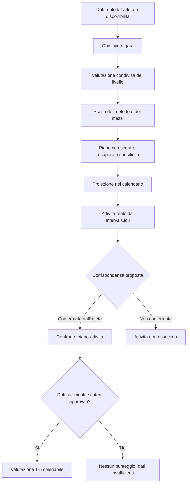

# Base metodologica per i programmi di allenamento

## Fonte e ambito

Questa sintesi deriva dai due PDF locali del manuale *Tipi che corrono*. I riferimenti indicano le pagine stampate nel libro, non il numero delle scansioni. Il testo è stato rielaborato: non è una trascrizione del manuale.

Riferimenti principali:

- Categorie di runner e legenda delle sigle: pp. 13–17.
- Principi e mezzi per l'amatore, inclusi esempi di programmi: pp. 149–216.
- Mezzi per il runner evoluto e relativi esempi: da circa p. 231.
- Indicazioni specifiche per trail amatoriale: pp. 214–216.

Il manuale propone esempi per la corsa su strada e per il trail, ma non costituisce da solo una valutazione individuale né un protocollo medico. Le sue categorie e i suoi chilometraggi sono descrittivi dell'autore; non vanno trasformati in soglie automatiche dell'app.

## Diagramma del flusso

Il livello è da concordare con l'atleta: l'app non lo deduce da un singolo dato, dalla sola distanza settimanale o dal risultato di una gara. Prima di generare un piano personale occorrono almeno obiettivo, esperienza recente, disponibilità settimanale e contesto del percorso.

## Legenda sintetica

### Intensità respiratorie

| Sigla | Significato nel manuale | Uso nella logica dell'app |
|---|---|---|
| CRMF | Corsa a respirazione molto facile | Recupero o corsa molto tranquilla |
| CRF | Corsa a respirazione facile | Lavoro facile e parti di corsa lunga |
| CRLI | Corsa a respirazione leggermente impegnata | Intensità intermedia |
| CRI | Corsa a respirazione impegnata | Tratti impegnativi, secondo il livello |
| CRMI | Corsa a respirazione molto impegnata | Intensità elevata; da prescrivere con cautela |

Le sigle descrivono la percezione respiratoria; non sono ritmi al km universali. L'OCR della tabella originale è imperfetto: prima di codificare ulteriori abbreviazioni, verificare la pagina scansionata.

### Mezzi e riferimenti

| Sigla | Significato |
|---|---|
| LS / L | Lentissimo / lento |
| B / T | Bis / tris: sedute con variazioni di ritmo |
| M / P | Medio / progressivo |
| PA / F | Ripetute brevi / fartlek |
| CVS | Corto veloce in salita |
| LLU / LLM | Lunghissimo ultra / lunghissimo maratona |
| DA / DAU | Day After / Day After Ultra |
| TR | Tempo Run |
| VR | Velocità di riferimento, da definire con un test appropriato |
| RG / RMA / RME / RUM | Ritmo gara / maratona / mezza maratona / ultra |
| RRM | Ripetute a ritmo maratona |
| rec. | Recupero tra le ripetizioni |

Le sigle e i mezzi sono un vocabolario descrittivo, non una prescrizione. In particolare, la VR e i ritmi gara devono avere una misurazione recente e valida; se manca, non si inventa un passo.

## Logica di programmazione derivata

1. **Partire dai dati verificati.** Registrare obiettivo e data della gara, distanza e dislivello, esperienza recente, sedute disponibili, preferenze e attività già svolte. Dichiarare i dati mancanti invece di completarli con valori di esempio.
2. **Concordare il profilo.** Usare le descrizioni del manuale come orientamento, non come classificazione clinica o automatica. Un rientro dopo una lunga interruzione richiede una ripartenza prudente.
3. **Comporre le sedute.** Alternare lavori facili, eventuali stimoli qualitativi, corsa lunga e recupero in funzione della persona e dell'obiettivo. I programmi stampati sono esempi distinti per livello e distanza: durata e frequenza non si trasferiscono automaticamente all'utente.
4. **Gestire il carico nel tempo.** Il manuale mostra cicli di diversa durata e settimane di scarico in alcuni esempi. Non se ne ricava una regola universale né una percentuale fissa di aumento: ogni piano deve esplicitare la propria progressione e i giorni di recupero.
5. **Adattare il trail al percorso.** Per il trail contano familiarità con terreno e dislivello, gestione corsa/cammino e vincoli della gara. Il ritmo al km isolato non basta a rappresentare lo sforzo su salite, discese e fondo variabile. Le sedute specifiche vanno introdotte in modo coerente con obiettivo e preparazione.
6. **Confermare le attività.** Una seduta reale può essere proposta come possibile corrispondenza a una pianificata; l'associazione è salvata solo dopo la conferma dell'atleta.
7. **Valutare l'aderenza senza inventare dati.** Il punteggio 1–5 è una funzionalità dell'app, non una scala definita dal manuale. Prima di attivarlo occorre approvare criteri trasparenti per tipo di seduta e dati disponibili (per esempio intervalli, durata, distanza o potenza). Se i dati sono incompleti o la seduta non è confermata, mostrare “non valutabile”, non un voto presunto.

## Limiti e salvaguardie

- Non assegnare una categoria o generare carichi personali basandosi solo su età, chilometri o singoli allenamenti.
- Non convertire automaticamente le intensità respiratorie in ritmi fissi; terreno, condizioni e dati individuali cambiano il carico percepito.
- Non prescrivere recuperi mancanti, soglie, test, esercizi riabilitativi o indicazioni nutrizionali ricavati da OCR incerto.
- Le informazioni su infortuni, sintomi o idoneità richiedono un professionista sanitario; l'app può segnalare un dato mancante, non diagnosticare.
- Mantenere separati i principi sintetizzati dalla fonte e le regole operative dell'app, che dovranno essere versionate e spiegabili.
